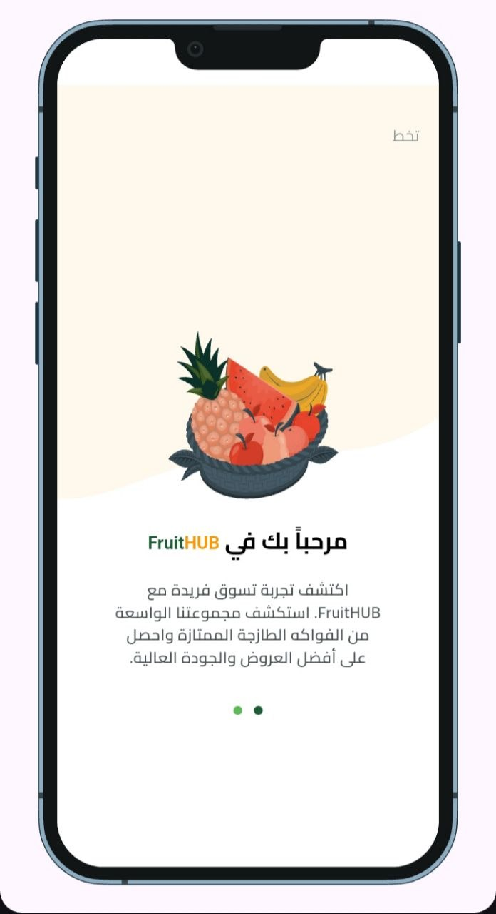
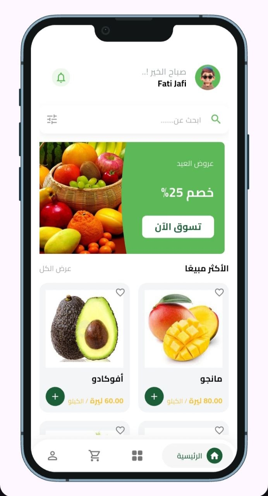
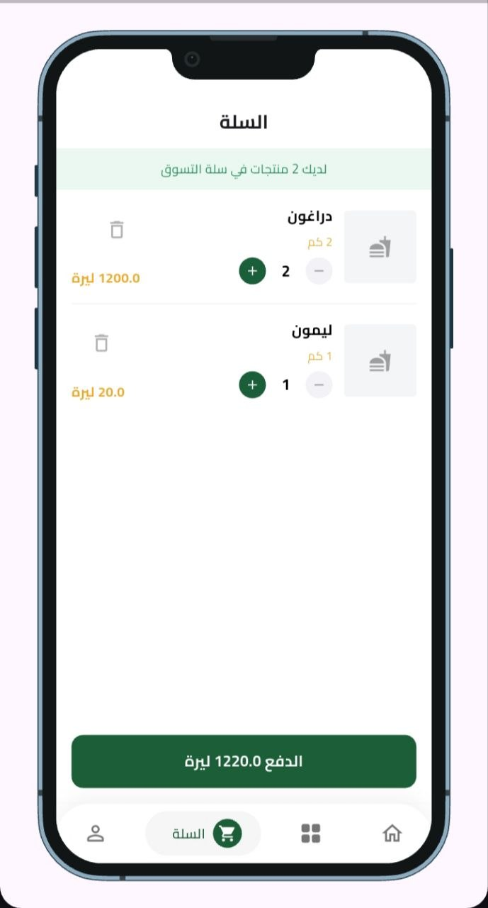
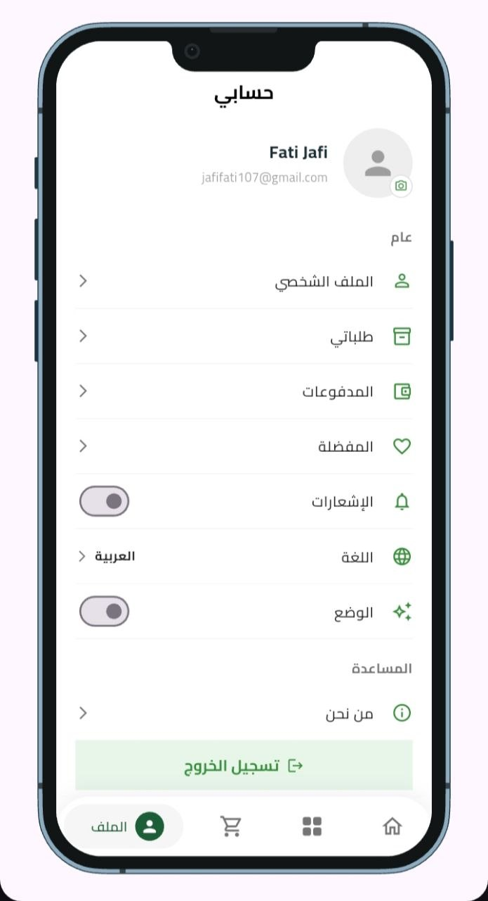

# 🍏 FruitHUP — E-Commerce Mobile Application

<p align="center">
  <b>A modern, feature-rich cross-platform mobile application for ordering fresh fruits, built with Flutter and engineered using Clean Architecture best practices.</b>
</p>

<p align="center">
  
  
  
  
  
  
</p>

---

## 📌 Overview

**FruitHUP** is a seamless cross-platform mobile e-commerce solution designed to deliver a smooth and intuitive fruit shopping experience for end users. 

The application is engineered prioritizing scalability, maintainability, and code testability. It adheres strictly to **Clean Architecture** principles, keeping a clear separation of concerns across Data, Domain, and Presentation layers.

> 🔗 **Looking for the Management System?** Check out the [FruitHUP Admin Dashboard Repository](https://github.com/YOUR_USERNAME/FruitHUP-Admin) for product management and order controls.

---

## 📱 User Interface & Showcase

<p align="center">
   &nbsp;
   &nbsp;
   &nbsp;
   &nbsp;
   &nbsp;
  
</p>


---

## 🏗️ Architecture & Technical Stack

The core design follows enterprise-level mobile architecture standards:

* **Framework:** [Flutter](https://flutter.dev/) (Dart)
* **Architecture:** Clean Architecture (Data, Domain, Presentation layer separation)
* **State Management:** BLoC / Cubit pattern for predictable state handling
* **Navigation & Routing:** GoRouter for declarative routing and deep linking support
* **Dependency Injection:** GetIt service locator for clean dependency injection
* **Backend & Cloud Services:**
  * **Firebase Authentication:** Secure sign-up/sign-in and session management
  * **Cloud Firestore:** Real-time NoSQL database for products, categories, and order processing
  * **Supabase Storage:** High-performance media hosting
* **Local Data Persistence:** SharedPreferences & Hive

---

## ✨ Key Features

* 🔐 **Secure Authentication:** User sign-in/sign-up powered by Firebase Auth.
* 🛍️ **Interactive Catalog:** Browse fruits by categories, fast search, and detailed product info.
* 🛒 **Smart Shopping Cart:** Dynamic item quantity adjustment with real-time total calculation.
* 💳 **Streamlined Checkout:** Fast order placement and delivery detail management.
* ⚡ **Real-time Synchronization:** Instant catalog and price updates synced from the Admin Dashboard.
* 🎨 **Responsive UI/UX:** Modern, pixel-perfect layouts designed for mobile screens.

---

## 📁 Repository Structure

```text
lib/
├── core/                   # Utilities, constants, shared widgets, & theme configuration
├── features/
│   ├── auth/               # Authentication domain, data, and UI
│   ├── home/               # Product discovery, categories, and main feed
│   ├── cart/               # Cart state management and local persistence
│   └── checkout/           # Order placement and checkout workflow
└── main.dart               # App entry point